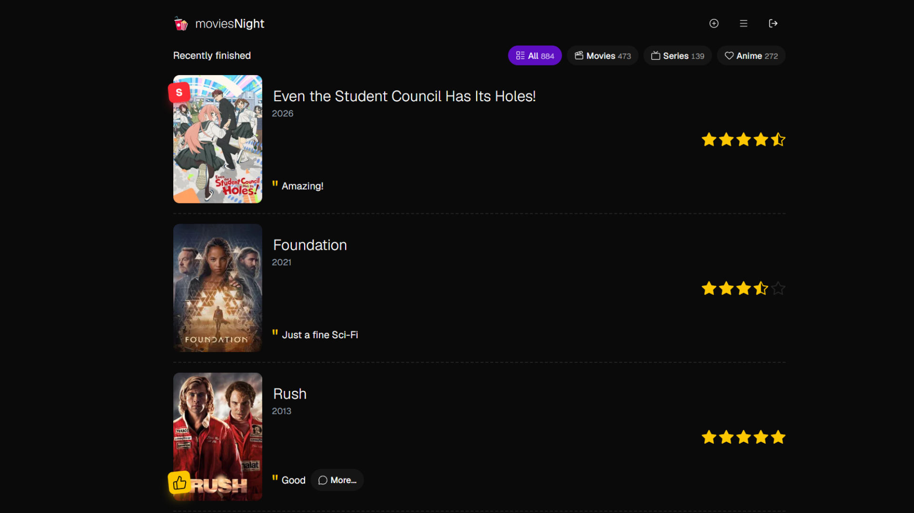

<p align="center">
  
</p>

<h1 align="center">moviesNight</h1>

<p align="center">
  A personal log of finished movies, series and anime — with ratings, short reviews, ranked lists and an anime tier list.
  <br />
  <a href="https://movies.juliuszlioba.com/"><strong>movies.juliuszlioba.com</strong></a>
</p>



## Features

- **Watch history** — chronological feed of finished titles, filterable by _All_, _Movies_, _Series_ and _Anime_ with live counts.
- **Record pages** — poster, rating (1–10 shown as stars), one-line recommendation, full review and extra details (overview, runtime, seasons and episodes) pulled from TMDB.
- **Search** — find any logged title by name.
- **Top lists** — hand-ordered favourite movies and series.
- **Anime ranking** — ordered list of every finished anime, with a drag-and-drop sort editor (mouse and touch).
- **Anime tier list** — S–F tiers with posters, ratings and recommendation tooltips; tiers can be suggested from the rating.
- **Admin tools** — add titles straight from a TMDB search, edit and delete records. Single-user: sign-ups are disabled and editing requires login.

## Tech stack

| Area      | Tools                                                                  |
| --------- | ---------------------------------------------------------------------- |
| Framework | [Next.js 16](https://nextjs.org/) (App Router, Server Components), React 19, TypeScript |
| Data & auth | [Supabase](https://supabase.com/) (Postgres, Auth, Row Level Security) |
| UI        | Tailwind CSS 4, [shadcn/ui](https://ui.shadcn.com/) on Radix, Lucide icons |
| Forms     | React Hook Form + Zod                                                  |
| Metadata  | [TMDB API](https://developer.themoviedb.org/)                          |
| Hosting   | Vercel (Analytics, Speed Insights)                                     |

## Getting started

### Prerequisites

- Node.js 20.9 or newer
- [pnpm](https://pnpm.io/)
- [Docker](https://www.docker.com/) (for the local Supabase stack)
- A [TMDB API key](https://www.themoviedb.org/settings/api)

### Setup

```bash
git clone https://github.com/juliuszlioba/moviesnight-nextjs-supabase.git
cd moviesnight-nextjs-supabase
pnpm install
cp .env.example .env
```

Start the local database. Migrations and seed data in `supabase/` are applied automatically:

```bash
pnpm supabase start
```

Copy the API URL and publishable key printed by the command into `.env` (see [Environment variables](#environment-variables)), then start the dev server:

```bash
pnpm dev
```

The app runs at [http://localhost:3000](http://localhost:3000).

To log in locally, create a user in Supabase Studio at [http://127.0.0.1:54323](http://127.0.0.1:54323) → **Authentication** → **Add user**.

When you are done, stop the database so it doesn't keep running in the background:

```bash
pnpm supabase stop
```

### Environment variables

| Variable                               | Description                                  |
| -------------------------------------- | -------------------------------------------- |
| `NEXT_PUBLIC_SUPABASE_URL`             | Supabase project URL                         |
| `NEXT_PUBLIC_SUPABASE_PUBLISHABLE_KEY` | Supabase publishable (anon) key              |
| `TMDB_API_KEY`                         | TMDB API key, used server-side only          |
| `TMDB_SESSION_ID`                      | Optional. TMDB session for syncing to your TMDB account (see below) |
| `NEXT_PUBLIC_POSTS_LIMIT`              | Records per page in list views (default `20`) |
| `NEXT_PUBLIC_POSTS_GRID_LIMIT`         | Records per page in grid views (default `40`) |

### TMDB account sync

With `TMDB_SESSION_ID` set, the app mirrors changes to your TMDB account:

- **Adding a record** removes the title from your TMDB watchlist.
- **Saving a score** (1–10) sets your TMDB rating to the same value; a score of `0` removes the TMDB rating. Rated titles are what TMDB treats as watched.

To create the session id, run `pnpm tmdb:session`, approve the request in the browser, and copy the printed value into `.env`. The session does not expire, but it can be revoked from your TMDB account settings. If syncing fails, the record is still saved and a warning is shown; if TMDB rejects the session, the warning tells you to run `pnpm tmdb:session` again and update `TMDB_SESSION_ID`.

## Scripts

| Command                | Description                    |
| ---------------------- | ------------------------------ |
| `pnpm dev`             | Start the development server   |
| `pnpm build`           | Create a production build      |
| `pnpm start`           | Serve the production build     |
| `pnpm lint`            | Run ESLint                     |
| `pnpm tmdb:session`    | Create a TMDB session id for account sync |

### Database

```bash
# Apply pending migrations to the local database
pnpm supabase migration up

# Regenerate TypeScript types after schema changes
pnpm supabase gen types typescript --local > ./lib/database.types.ts
```

## Project structure

```
app/          Routes (home feed, record pages, search, top lists, anime ranking & tier list)
components/   UI components; records/ holds list, item, form and sort components
lib/          Data access (records.ts), server actions, schemas, config, Supabase clients
supabase/     Local Supabase config, migrations and seed data
public/       Static assets
docs/         README assets
```

## Attribution

This product uses the [TMDB API](https://www.themoviedb.org/documentation/api) but is not endorsed or certified by TMDB.


## AI-assisted development

Parts of this project were built with the help of AI coding assistants, used through the [T3 Code](https://t3.codes/) app (running Claude models). AI was used to implement features, refactor code and review changes. Every change was reviewed, tested and approved by the author before being committed. Commits produced with AI help are marked with a `Co-Authored-By` trailer.
